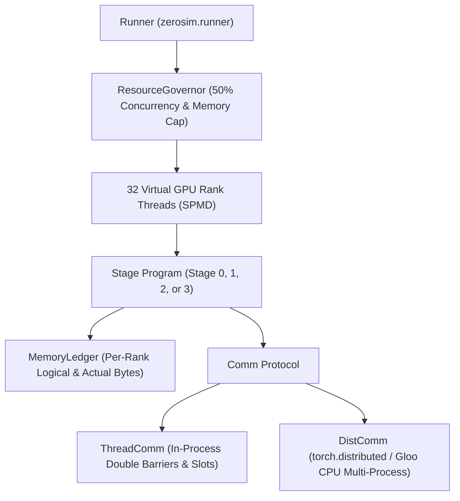
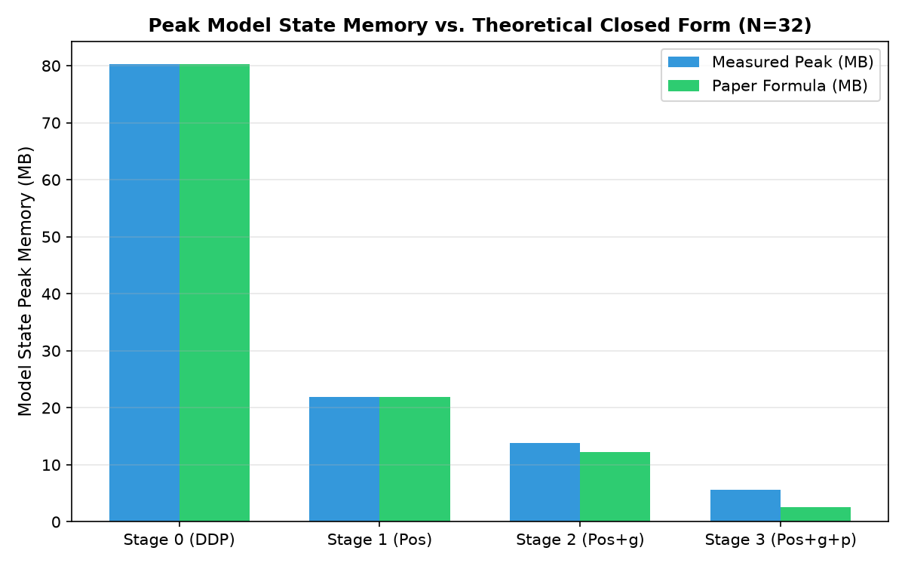
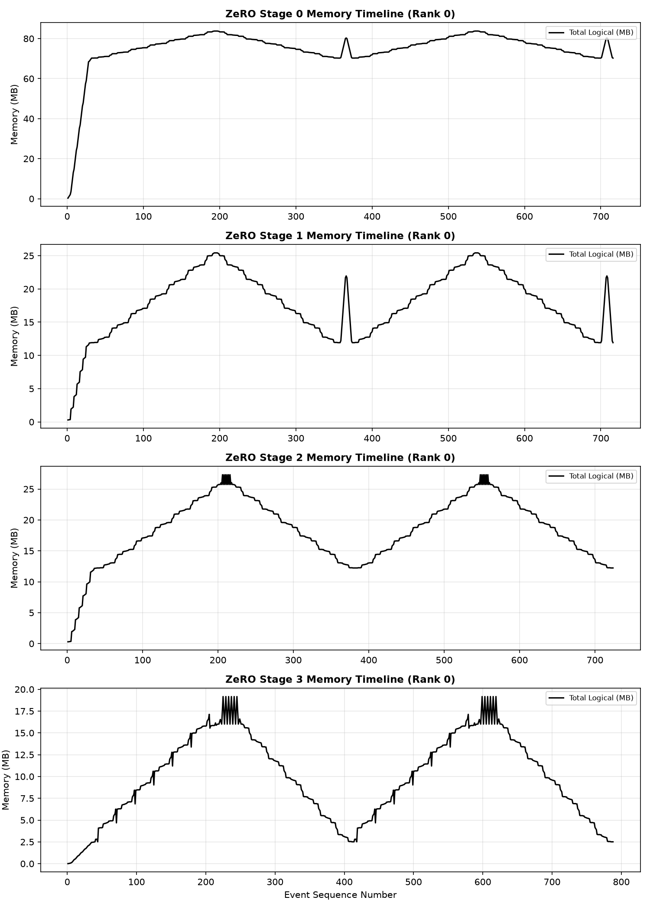
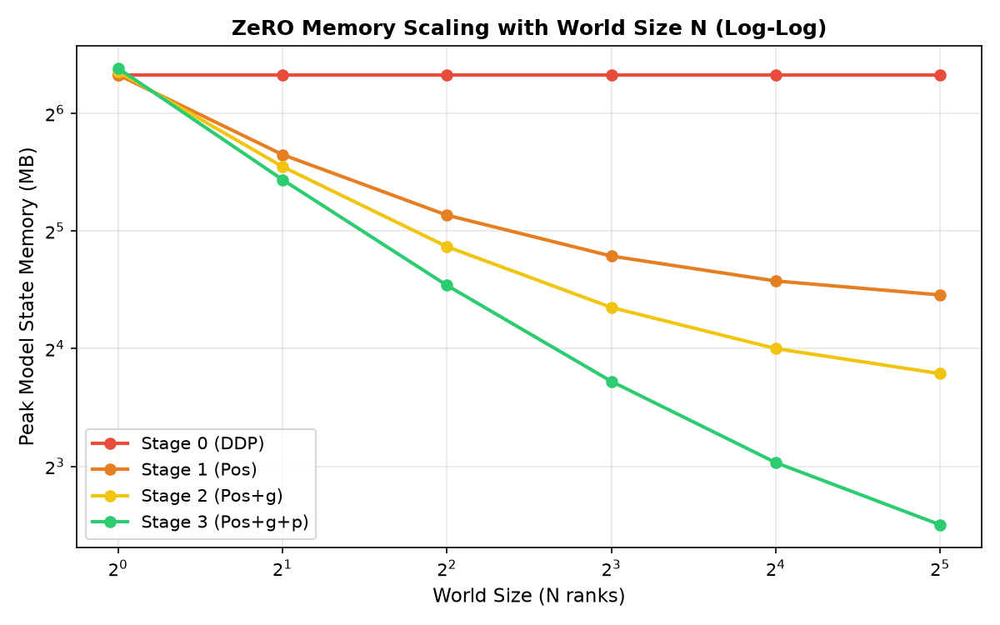

# ZeRO Optimiser Simulation (32 Virtual GPUs)

[](https://github.com/thinkTinkerGreen/ZeRO_optimiser_simulation/actions/workflows/ci.yml)
[](https://github.com/thinkTinkerGreen/ZeRO_optimiser_simulation)
[](https://opensource.org/licenses/MIT)
[](https://colab.research.google.com/github/thinkTinkerGreen/ZeRO_optimiser_simulation/blob/main/notebooks/ZeRO_optimiser_sim.ipynb)

A state-of-the-art, deterministic, paper-faithful simulator and visualizer for the **Zero Redundancy Optimizer (ZeRO)** across 32 virtual GPUs. This project simulates and contrasts **Stage 0 (DDP baseline)**, **Stage 1 ($P_{os}$)**, **Stage 2 ($P_{os+g}$)**, and **Stage 3 ($P_{os+g+p}$)** on a modular decoder-only Transformer (GPT) model, tracking per-rank memory ledgers, exact communication volumes, collective synchronizations, and execution cost models.

---

## Quick Start

### Run in Google Colab (Free GPU / CPU)
Click the badge above or navigate to [`notebooks/ZeRO_optimiser_sim.ipynb`](notebooks/ZeRO_optimiser_sim.ipynb). The notebook automatically configures Google Drive persistence, runs within the 50% capacity resource governor, prompts for GitHub PAT (via secure runtime secrets) to sync results, and evaluates all stages.

### Run Locally
```bash
git clone https://github.com/thinkTinkerGreen/ZeRO_optimiser_simulation.git
cd ZeRO_optimiser_simulation

# Install dependencies using uv
uv venv --python 3.11
source .venv/bin/activate
uv pip install -e ".[dev,torch]"

# Run tests and linter
make lint
make type
make test
make test-dist
```

---

## What is Simulated vs. What is Not

| Feature | In Simulator | Real Production Systems |
|---|---|---|
| **Memory Sharding** | Exact tracking of parameter shards, gradient shards, optimizer states ($M, m, v$), and transient buffers via `MemoryLedger`. | Physical device allocation with CUDA caching allocator fragmentation. |
| **Stage 1 ($P_{os}$)** | Full grads retained until backward completes; reduce-scatter + all-gather ($2\Psi$ elements). | Same on-the-wire communication semantics. |
| **Stage 2 ($P_{os+g}$)** | Eager reduce-scatter during backward via post-accumulate hooks; immediate unit grad free. | Bucketed overlap with upstream backward computation. |
| **Stage 3 ($P_{os+g+p}$)** | Dynamic all-gather in forward/backward; recomputes unit forward in backward to prevent autograd retention ($3\Psi$ elements). | Recomputation is a simulation artifact; real systems use custom autograd hooks without forward recompute. |
| **Compute / Comm Overlap** | Model calculates $t = t_{\text{compute}} + t_{\text{comm}}$ explicitly without pipelined overlap. | NCCL communication streams overlapped with compute kernels. |
| **Offload & ZeRO-R** | Not simulated (in-core execution; activation memory tracked via autograd saved tensors hooks). | ZeRO-Offload (CPU/NVMe) and ZeRO-R activation partitioning. |

---

## Architecture



---

## Experimental Results

All tables below are automatically rendered from committed results JSON files using `tools/render_readme_tables.py`.

### E0: Paper Table 1 Reproduction
<!-- BEGIN:generated:TABLE1 -->
| Model | N | ZeRO Stage | Printed (GB) | Computed (GB) | Status |
|---|---|---|---|---|---|
| 7.5B | 1 | $P_{os}$ (Stage 1) | 120.0 | 120.0 | ✅ Pass |
| 7.5B | 1 | $P_{os+g}$ (Stage 2) | 120.0 | 120.0 | ✅ Pass |
| 7.5B | 1 | $P_{os+g+p}$ (Stage 3) | 120.0 | 120.0 | ✅ Pass |
| 7.5B | 64 | $P_{os}$ (Stage 1) | 31.4 | 31.41 | ✅ Pass |
| 7.5B | 64 | $P_{os+g}$ (Stage 2) | 16.6 | 16.64 | ✅ Pass |
| 7.5B | 64 | $P_{os+g+p}$ (Stage 3) | 1.88 | 1.88 | ✅ Pass |
| 7.5B | 1024 | $P_{os}$ (Stage 1) | 30.1 | 30.09 | ✅ Pass |
| 7.5B | 1024 | $P_{os+g}$ (Stage 2) | 15.1 | 15.1 | ✅ Pass |
| 7.5B | 1024 | $P_{os+g+p}$ (Stage 3) | 0.12 | 0.12 | ✅ Pass |
| 128B | 1 | $P_{os}$ (Stage 1) | 2048.0 | 2048.0 | ✅ Pass |
| 128B | 1 | $P_{os+g}$ (Stage 2) | 2048.0 | 2048.0 | ✅ Pass |
| 128B | 1 | $P_{os+g+p}$ (Stage 3) | 2048.0 | 2048.0 | ✅ Pass |
| 128B | 64 | $P_{os}$ (Stage 1) | 536.0 | 536.0 | ✅ Pass |
| 128B | 64 | $P_{os+g}$ (Stage 2) | 284.0 | 284.0 | ✅ Pass |
| 128B | 64 | $P_{os+g+p}$ (Stage 3) | 32.0 | 32.0 | ✅ Pass |
| 128B | 1024 | $P_{os}$ (Stage 1) | 513.0 | 513.5 | ✅ Pass |
| 128B | 1024 | $P_{os+g}$ (Stage 2) | 257.0 | 257.75 | ✅ Pass |
| 128B | 1024 | $P_{os+g+p}$ (Stage 3) | 2.0 | 2.0 | ✅ Pass |
| 1T | 1 | $P_{os}$ (Stage 1) | 16000.0 | 16000.0 | ✅ Pass |
| 1T | 1 | $P_{os+g}$ (Stage 2) | 16000.0 | 16000.0 | ✅ Pass |
| 1T | 1 | $P_{os+g+p}$ (Stage 3) | 16000.0 | 16000.0 | ✅ Pass |
| 1T | 64 | $P_{os}$ (Stage 1) | 4187.0 | 4187.5 | ✅ Pass |
| 1T | 64 | $P_{os+g}$ (Stage 2) | 2218.0 | 2218.75 | ✅ Pass |
| 1T | 64 | $P_{os+g+p}$ (Stage 3) | 250.0 | 250.0 | ✅ Pass |
| 1T | 1024 | $P_{os}$ (Stage 1) | 4011.0 | 4011.72 | ✅ Pass |
| 1T | 1024 | $P_{os+g}$ (Stage 2) | 2013.0 | 2013.67 | ✅ Pass |
| 1T | 1024 | $P_{os+g+p}$ (Stage 3) | 15.6 | 15.62 | ✅ Pass |

*Summary: 54/54 cells passed (54 / 54).*
<!-- END:generated:TABLE1 -->

### E1: Memory Footprint Across 32 Virtual GPUs (`demo` config, 5M parameters)
<!-- BEGIN:generated:E1_MEMORY -->
| Stage | Paper Stage | Measured Peak (MB) | Theoretical Closed Form (MB) | Savings vs DDP | Load Uniformity across 32 Ranks |
|---|---|---|---|---|---|
| Stage 0 | Baseline DP | **80.29 MB** | 80.29 MB | **1.00×** | ✅ Bit-identical |
| Stage 1 | $P_{os}$ | **21.95 MB** | 21.95 MB | **3.66×** | ✅ Bit-identical |
| Stage 2 | $P_{os+g}$ | **13.81 MB** | 12.23 MB | **5.81×** | ✅ Bit-identical |
| Stage 3 | $P_{os+g+p}$ | **5.67 MB** | 2.51 MB | **14.16×** | ✅ Bit-identical |
<!-- END:generated:E1_MEMORY -->


*Figure 1: Peak model-state memory per rank across stages compared to theoretical closed-form bounds.*


*Figure 2: Per-rank memory timeline across forward, backward, comm, and optimizer phases (Rank 0).*

### E3: Computation & Communication Profiling
<!-- BEGIN:generated:E3_COMPUTE_COMM -->
| Stage | FWD FLOPs | BWD FLOPs | Z3 Recompute FLOPs | Optimizer FLOPs | Comm Elements (Units of $\Psi$) | Modeled Step Time (NVLink) | Modeled Step Time (InfiniBand) |
|---|---|---|---|---|---|---|---|
| Stage 0 | 645,922,816 | 1,291,845,632 | 0 | 50,181,120 | **2$\Psi$** | 0.204 ms | 1.695 ms |
| Stage 1 | 645,922,816 | 1,291,845,632 | 0 | 1,568,160 | **2$\Psi$** | 0.242 ms | 1.733 ms |
| Stage 2 | 645,922,816 | 1,291,845,632 | 0 | 1,568,160 | **2$\Psi$** | 0.242 ms | 1.733 ms |
| Stage 3 | 645,922,816 | 1,291,845,632 | 645,922,816 | 1,568,160 | **3$\Psi$** | 0.346 ms | 2.583 ms |
<!-- END:generated:E3_COMPUTE_COMM -->

### E4: Scaling Sweep ($N = 1$ to $32$)
<!-- BEGIN:generated:E4_SCALING -->
| World Size $N$ | Stage 0 (MB) | Stage 1 (MB) | Stage 2 (MB) | Stage 3 (MB) | Stage 3 Reduction vs DP |
|---|---|---|---|---|---|
| $N = 1$ | 80.29 MB | 80.29 MB | 81.87 MB | **83.45 MB** | **0.96×** |
| $N = 2$ | 80.29 MB | 50.18 MB | 46.74 MB | **43.30 MB** | **1.85×** |
| $N = 4$ | 80.29 MB | 35.13 MB | 29.18 MB | **23.23 MB** | **3.46×** |
| $N = 8$ | 80.29 MB | 27.60 MB | 20.40 MB | **13.20 MB** | **6.08×** |
| $N = 16$ | 80.29 MB | 23.84 MB | 16.01 MB | **8.18 MB** | **9.82×** |
| $N = 32$ | 80.29 MB | 21.95 MB | 13.81 MB | **5.67 MB** | **14.16×** |
<!-- END:generated:E4_SCALING -->


*Figure 3: Log-log scaling curve demonstrating the $1/N$ memory scaling of ZeRO-3.*

---

## Comparison to Frameworks (FSDP2 & DeepSpeed)

| Feature | DeepSpeed | PyTorch FSDP2 | zerosim Simulator |
|---|---|---|---|
| **Stage 1 ($P_{os}$)** | `"zero_optimization": {"stage": 1}` | Not directly supported | `zerosim.stages.Stage1` |
| **Stage 2 ($P_{os+g}$)** | `"zero_optimization": {"stage": 2}` | Not directly supported | `zerosim.stages.Stage2` |
| **Stage 3 ($P_{os+g+p}$)** | `"zero_optimization": {"stage": 3}` | `torch.distributed.fsdp.fully_shard` | `zerosim.stages.Stage3` |
| **Communication Volume** | $2\Psi$ (Stg 1/2), $3\Psi$ (Stg 3) | $3\Psi$ (`fully_shard`) | $2\Psi$ (Stg 0/1/2), $3\Psi$ (Stg 3) |
| **Sharding Granularity** | Flat parameter partitioning | Per-parameter `DTensor` sharding | Unit-wise flat sharding |

*(Note: DeepSpeed version cited: v0.19.7. FSDP2 verified from PyTorch official docs).*

---

## Reproducibility & SDLC Standards

- **Determinism:** Governed by `zerosim.determinism.seed_everything` with deterministic PyTorch operations and ordered reductions.
- **Continuous Integration:** GitHub Actions matrix across Python 3.11, 3.12, 3.13, ensuring:
  - Ruff lint & format checks
  - Pyright strict static typing
  - Pytest with coverage $\ge 90\%$
  - Multi-process distributed parity (`dist-parity.yml`)
  - Dependency security audits (`pip-audit`, CodeQL)
- **Architecture Decision Records (ADRs):** Comprehensive decision log in [`docs/adr/`](docs/adr/).
- **Study Guide:** In-depth educational guide for learning ZeRO from scratch in [`docs/STUDY_GUIDE.md`](docs/STUDY_GUIDE.md).

---

## My Understanding

> **Updated my understanding:** See [`docs/UNDERSTANDING.md`](docs/UNDERSTANDING.md).

---

## Limitations & Known Issues

See [`docs/KNOWN_ISSUES.md`](docs/KNOWN_ISSUES.md) for full technical limitations.
